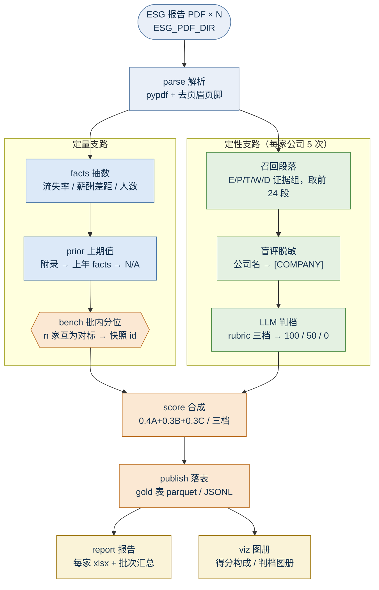

# 当前管道：定量分档 + 定性判档（s11-model-1.5）

> 图：[`pipeline_flow.png`](pipeline_flow.png)（由 [`make_pipeline_diagram.py`](make_pipeline_diagram.py) 生成）
> 口径来源：`指标的基本共识.md`（定量→数值分档；定性→关键词匹配段落 + LLM 语义判档，关键词匹配程度兜底）+ `rubric.py` 的五份三档判据。

## Mermaid 版（GitHub / 支持 Mermaid 的编辑器可直接渲染）



## 两条支路各管什么

| | 定量支路 | 定性支路 |
|---|---|---|
| 覆盖 | S1.1.1 A/B、S1.1.2 A/B | S1.1.1-C、S1.1.2-C、S1.1.3、S1.1.4、S1.1.5 |
| 输入 | PDF 里的数值 | 关键词命中的段落（≤24 段） |
| 判据 | 指标值 → 档位（100/75/50/25/0 或 100/50/0） | rubric 三档判据原文 → 100/50/0 |
| 谁在做判断 | 算术 + 批内分位（`bench.py`） | LLM（`qualitative.judge_llm`），失败降级关键词（`judge_keyword`） |
| 依赖 | `facts` / `prior` / `bench` | `parse`（+ `facts` 的流失率闸门） |
| 产物 | `facts.json` `prior.json` `bench_*`（+ `build/bench/FY{year}/{snapshot}.json`，可被 `--bench-snapshot` 读回） | `qualitative-<模式>.json`（llm / keyword 各存一份） |

## 定性支路的四道保险

1. **关键词只管召回，不管分**：`recall()` 按命中数排序取前 24 段，命中多只是"多给模型看几段"，不直接加分。港交所套话与 GRI 索引行降权，同分时带年份/比例的段落优先。
2. **档位硬约束**：只能 100 / 50 / 0。模型给别的值 → `_coerce_tier` 判无效 → 触发降级，绝不四舍五入猜一个分。
3. **盲评脱敏**：送出去之前把公司名替成 `[COMPANY]`；替换后仍扫到残留就**不发送**，直接退回关键词兜底（fail closed）。
4. **兜底保守**：关键词兜底按证据层级给档——只命中"制度或声明"→50，"制度 + 执行结果"→100。宁可按低档。

## 判档模式

默认 `--qualitative llm`（盲评判档）；没有可用 key 时自动退 `keyword`（离线兜底）。
判档结论**直接是分**：C 项与 S1.1.3/4/5 取 100/50/0，没有任何词法拼装层。

```powershell
python -m esg_s11_scorer                    # 默认 llm；无 key 时自动降级 keyword
python -m esg_s11_scorer --qualitative llm       # 明确要求 LLM 盲评判档
python -m esg_s11_scorer --qualitative keyword   # 不联网：关键词兜底判档
```

两种模式都会写出 `qualitative-<模式>.json` 与 `S1.1_定性判档_YYYY.xlsx`（判档图册）。
**两种模式各存一份产物**：跑过 keyword 不会顶掉 llm 的缓存。

## 报告里有什么

默认只写一份批次汇总：`汇总`、`对标分位`、`分项明细`（全批 × 5 指标 × 各分项，含算式）、`运行台账`。
单家工作簿（`总览` / `分项明细` / `数据取值` / `运行台账`）是**按需**产物：加 `--company-reports` 才写，
读的是同一份 gold 表，不重算分数。